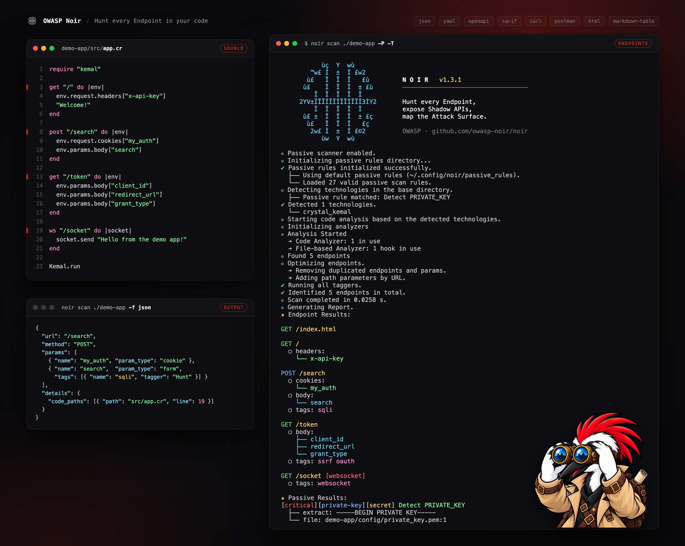
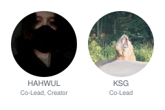

<div align="center">
  <picture>
    <source media="(prefers-color-scheme: dark)" srcset="https://github.com/owasp-noir/noir/assets/13212227/04aee7d0-c224-481b-8d79-2dbdcf3ad84b" width="500px;">
    <source media="(prefers-color-scheme: light)" srcset="https://github.com/owasp-noir/noir/assets/13212227/0577860e-3d7e-4294-8f1f-dc7b87ce2b2b" width="500px;">
    
  </picture>
  <p>Hunt every Endpoint in your code, expose Shadow APIs, map the Attack Surface!</p>
</div>

<p align="center">
<a href="https://github.com/owasp-noir/noir/releases">
</a>
<a href="https://crystal-lang.org">
</a>
<a href="https://owasp.org/projects/noir">
</a>
<a href="https://www.bestpractices.dev/projects/14203">
</a>
<a href="https://github.com/owasp-noir/noir/blob/main/.github/CONTRIBUTING.md">
</a>
</p>

<p align="center">
  <a href="https://owasp-noir.github.io/noir/">Documentation</a> •
  <a href="https://owasp-noir.github.io/noir/get_started/installation/">Installation</a> •
  <a href="#usage">Usage</a> •
  <a href="https://owasp-noir.github.io/noir/usage/github_action/">GitHub Action</a> •
  <a href="#contributing">Contributing</a> •
  <a href="./CHANGELOG.md">Changelog</a>
</p>

Noir is a SAST tool that reads source code and lists the endpoints an application exposes: paths, methods, parameters, headers, cookies, and the source files behind them. Shadow APIs, deprecated routes, and undocumented handlers are in the same inventory.

The inventory has three readers:

- **Human reviewers** start from attacker-reachable entry points instead of the whole repo.
- **AI auditors** get the same list plus per-endpoint review context (`--include callee`, `--ai-context`).
- **DAST tools** (ZAP, Burp Suite, Caido, Gori) get routes a crawler would never reach.

## What Noir does

- **Endpoint extraction.** Static analysis across [264 frameworks](https://owasp-noir.github.io/noir/usage/supported/language_and_frameworks/).
- **LLM fallback.** OpenAI, Ollama, and other providers cover frameworks the static rules don't.
- **Output formats.** JSON, YAML, OpenAPI, SARIF, cURL, Postman, HTML, and more.
- **DAST integration.** Send endpoints to ZAP, Burp Suite, Caido, or Gori through a proxy, or export OpenAPI.
- **AI review context.** `--include callee` adds the functions each handler calls; `--ai-context` adds guards, sources, sinks, validators, and signals.
- **CI/CD.** GitHub Action, SARIF output, and exit codes.

## Usage

```bash
brew install noir
noir scan <source_dir>
```



Other install methods (Snap, Docker, npm, Nix, packages) are on the [Installation](https://owasp-noir.github.io/noir/get_started/installation/) page. Run `noir -h` for every flag, or see the [documentation](https://owasp-noir.github.io/noir/) and the [GitHub Action](https://owasp-noir.github.io/noir/usage/github_action/) page.

## Roadmap

Noir started as a way to hand DAST tools the routes found in source code. The same inventory now serves human reviewers and AI auditors too, and the roadmap treats all three equally:

- Broaden language and framework coverage, with per-framework fixtures to check accuracy.
- Use LLMs where static analysis can't reach.
- Enrich the per-endpoint review context (guards, callees, sinks, validators, signals).
- Keep DAST integration first-class: OpenAPI, proxy targets, and hand-offs to ZAP, Burp Suite, Caido, and Gori.

## OWASP Project

OWASP Noir joined the OWASP Foundation in **June 2024**.

- Official project page: [https://owasp.org/projects/noir](https://owasp.org/projects/noir)
- OWASP Nest: [https://nest.owasp.org/projects/noir](https://nest.owasp.org/projects/noir)

## News & Updates

* Nov 2026: Conducted a hands-on session at [OWASP Korea Day 2026](https://www.owaspkr.org/2026/)
* May 2026: Released **v1.0.0**, the stable 1.x line with a verb-based CLI.
* May 2026: Refreshed the roadmap to serve human reviewers, AI auditors, and DAST tools equally.
* August 2025: Presented at the OWASP Seoul Meetup. ([Open Source Gardening](https://owasp-noir.github.io/noir/community/media/#featured-owasp-seoul-aug-2025-open-source-gardening))
* November 2024: Published a guest blog post ["Powering Up DAST with ZAP and Noir"](https://www.zaproxy.org/blog/2024-11-11-powering-up-dast-with-zap-and-noir/) on the ZAP blog.
* June 2024: Joined OWASP as OWASP Noir
  * Renamed the GitHub organization from noir-cr to owasp-noir
  * Transitioned to co-leadership with [@ksg97031](https://github.com/ksg97031)
* November 2023: Moved the Noir repository to the noir-cr GitHub organization.
* August 2023: Started as [@hahwul](https://github.com/hahwul)'s personal project.

## Core Team

[](https://owasp-noir.github.io/noir/resources/contact/)

## Contributing

Noir is an open-source project made with ❤️.
To contribute, see [CONTRIBUTING.md](./.github/CONTRIBUTING.md) and open a pull request.

[](https://github.com/owasp-noir/noir/graphs/contributors)

## Mascot

Hak (학) is Noir’s mascot, named after the Korean word for crane.


The wallpaper draws on an [Inwangsan photograph from the Seoul Tourism Archive](https://commons.wikimedia.org/wiki/File:Downtown_Seoul_from_Inwangsan_in_2023.jpg), licensed under [KOGL Type 1](https://www.kogl.or.kr/info/licenseType1.do).

More artwork is in the [noir-artwork repository](https://github.com/owasp-noir/noir-artwork).
