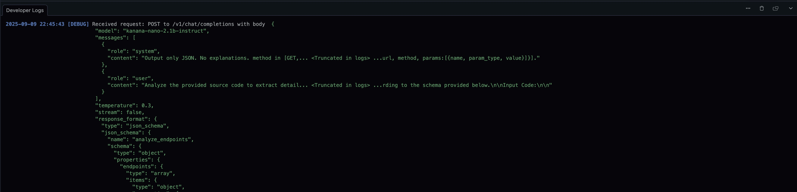
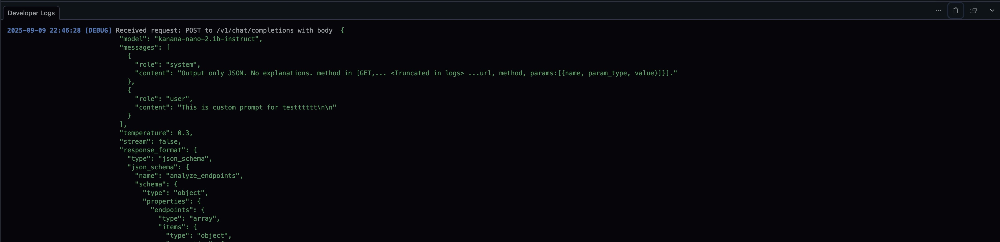

+++
title = "숨겨진 플래그로 디버그"
description = "디버깅과 실험을 위한 개발자 전용 숨겨진 플래그"
weight = 3
sort_by = "weight"

+++

`--help` 출력에 나오지 않는 개발자 전용 플래그입니다. 이름, 동작, 제공 여부는 예고 없이 바뀔 수 있습니다.

Noir가 LLM에 보내는 프롬프트를 바꾸는 플래그라서, AI 분석을 켰을 때만 효과가 있습니다(`--ai-provider`, 대부분의 제공업체는 `--ai-model`도 필요).

## 사용 가능한 플래그

- `--override-analyze-prompt`: 개별 파일 분석용 내부 ANALYZE_PROMPT를 덮어씁니다.
- `--override-llm-optimize-prompt`: 엔드포인트 최적화용 내부 LLM_OPTIMIZE_PROMPT를 덮어씁니다.
- `--override-bundle-analyze-prompt`: 번들(다중 파일) 분석용 내부 BUNDLE_ANALYZE_PROMPT를 덮어씁니다.
- `--override-filter-prompt`: 파일 필터링용 내부 FILTER_PROMPT를 덮어씁니다.

## 언제 쓰나요

- 분석/필터링/최적화 프롬프트 전략을 실험할 때
- 다시 빌드하지 않고 빠르게 반복 테스트할 때
- 프롬프트 변화가 결과 품질에 미치는 영향을 비교할 때

## 사용 팁

- 프롬프트는 별도 인자로 넘기세요. `--flag=value` 형식은 거부되고, `-`로 시작하는 값도 거부됩니다.
- 프롬프트 문자열을 따옴표로 감싸 공백과 특수문자를 보존하세요.
- 여러 줄 프롬프트는 파일에 두고 명령 치환으로 읽어오세요.
- 작은 픽스처로 먼저 검증한 뒤 범위를 넓히세요.
- `-d` / `--debug`를 함께 쓰면 AI 분석기의 중간 단계(파일 필터링, 번들, 오류)를 볼 수 있습니다.

## 예시

짧은 리터럴 프롬프트 (개별 파일 분석 덮어쓰기)

```bash
./bin/noir scan spec/functional_test/fixtures/crystal \
  --override-analyze-prompt 'HTTP 엔드포인트와 파라미터를 식별하고, 간결한 구조화된 결과를 반환하라.'
```

파일에서 여러 줄 프롬프트 읽어오기 (분석 덮어쓰기)

```bash
./bin/noir scan spec/functional_test/fixtures/crystal \
  --override-analyze-prompt "$(cat prompts/analyze_prompt.txt)"
```

LLM 최적화 프롬프트 덮어쓰기

```bash
./bin/noir scan spec/functional_test/fixtures/crystal \
  --override-llm-optimize-prompt "$(cat prompts/llm_optimize_prompt.txt)"
```

번들 분석 프롬프트 덮어쓰기 (여러 파일 추론)

```bash
./bin/noir scan spec/functional_test/fixtures/crystal \
  --override-bundle-analyze-prompt "$(cat prompts/bundle_analyze_prompt.txt)"
```

파일 필터링 프롬프트 덮어쓰기

```bash
./bin/noir scan spec/functional_test/fixtures/crystal \
  --override-filter-prompt 'HTTP 라우트나 미들웨어를 선언할 가능성이 있는 애플리케이션 소스만 선택하라.'
```

## 주의사항

- 프롬프트 내용과 LLM 동작에 따라 실행마다 출력이 달라질 수 있습니다.
- 셸이 문자를 예상과 다르게 해석하면 작은따옴표를 쓰거나 파일에서 읽어오세요.
- AI 제공업체(API 키, 모델)를 먼저 설정하세요. `--ai-no-optimize`를 쓰면 `--override-llm-optimize-prompt`는 효과가 없습니다.

## 스크린샷 예시

플래그 없이 실행

```bash
./bin/noir scan ./spec/functional_test/fixtures/crystal/kemal --ai-provider=lmstudio --ai-model=kanana-nano-2.1b-instruct --exclude-techs kemal --cache-disable
```



--override-analyze-prompt 사용

```bash
./bin/noir scan ./spec/functional_test/fixtures/crystal/kemal --ai-provider=lmstudio --ai-model=kanana-nano-2.1b-instruct --exclude-techs kemal --cache-disable --override-analyze-prompt "This is custom prompt for testttttt"
```


