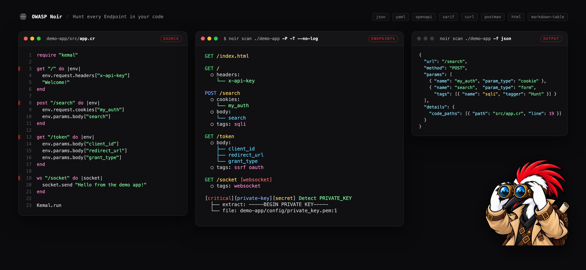

+++
title = "What is Noir?"
description = "OWASP Noir is a SAST tool that extracts endpoints from source code to feed human reviewers, AI auditors, and DAST scanners."
weight = 1
sort_by = "weight"
next_page_path = "/get_started/installation/"
next_page_label = "Install Noir"

+++


Hi! I'm Hak, the Noir mascot. Here's what Noir does.


Noir is an open-source SAST tool. It reads source code and extracts the endpoints an application exposes: paths, methods, parameters, headers, cookies, and the source files behind them. Shadow APIs and undocumented routes come out as part of the same inventory; they aren't a separate mode.

That inventory feeds three audiences:

- **Human reviewers.** Security engineers and code auditors get a focused list of attacker-reachable entry points and the files, parameters, and tags around them, instead of having to skim the whole repository.
- **AI auditors.** LLM-based SAST agents get the same focused list, plus per-endpoint review context (`--include callee` for 1-hop callees in plain output; `--ai-context` for guards, callees, sources, sinks, validators, and signals).
- **DAST tools.** ZAP, Burp Suite, and Caido get a real route list to scan, including paths they would never have reached by crawling.

## What Noir does

**Extract endpoints.** Static analysis pulls endpoints, parameters, headers, and cookies out of source, including the ones nobody documented.

**Cover the stack.** A single binary supports 261 frameworks across 32 languages, including Crystal, Go, Java, JavaScript, Kotlin, PHP, Python, Ruby, Rust, and Swift. No plugins or per-language setup.

**Fall back to an LLM.** When a framework isn't natively supported, or its routing is too custom for static rules, point Noir at an LLM (OpenAI, Ollama, and so on) to fill the gap.

**Feed DAST scanners.** Pipe endpoints straight into ZAP, Burp Suite, or Caido as a proxy target, or export OpenAPI for them to import. The scanner then also tests routes that no page links to.

**Give AI reviewers context.** An LLM-based SAST tool or security agent can start from the inventory instead of the whole repository. `--include callee` adds the functions each handler calls directly, and `--ai-context` adds guards, callees, sources, sinks, validators, and signals to each endpoint, so the model doesn't have to find them again.

**Export to whatever reads next.** JSON, YAML, OpenAPI, SARIF for CI/CD, cURL, HTTPie, HTML reports, Postman collections, and more.

## How it works

Point Noir at your source code and it automatically:

1. **Detects** which languages and frameworks your project uses
2. **Analyzes** the code to extract endpoints, parameters, and headers
3. **Reports** results in the format you choose


flowchart LR
    SourceCode:::highlight --> Detectors

    subgraph Detectors
        direction LR
        Detector1 & Detector2 & Detector3 --> |Condition| PassiveScan
    end

    PassiveScan --> |Results| BaseOptimizer

    Detectors --> |Techs| Analyzers

    subgraph Analyzers
        direction LR
        CodeAnalyzers & FileAnalyzer & LLMAnalyzer
        CodeAnalyzers --> |Condition| Minilexer
        CodeAnalyzers --> |Condition| Miniparser
    end
   subgraph Optimizer
       direction LR
       BaseOptimizer[Optimizer] --> LLMOptimizer[LLM Optimizer]
       LLMOptimizer[LLM Optimizer] --> OptimizedResult
       OptimizedResult[Result]
   end

    Analyzers --> |Condition| Deliver
    Analyzers --> |Condition| Tagger
    Deliver --> 3rdParty
    BaseOptimizer --> OptimizedResult
    OptimizedResult --> OutputBuilder
    Tagger --> |Tags| BaseOptimizer
    Analyzers --> |Endpoints| BaseOptimizer
    OutputBuilder --> Report:::highlight

    classDef highlight fill:#ee2a22,stroke:#ee2a22,stroke-width:2px,color:#0b0b0c;
    %% The entry and exit nodes carry the site accent. fill:#000 was safe
    %% while the docs were dark-only; under light mode the node label is
    %% near-black and vanished into the fill. Near-black on this red is
    %% 4.67:1, the same pairing the primary CTA uses.


## Contributing

Noir is open source and takes contributions. See the [Contributing Guide](https://github.com/owasp-noir/noir/blob/main/.github/CONTRIBUTING.md) for details.

### Core team

### Contributors

---

**Next**: [Install Noir](@/get_started/installation/index.md)
