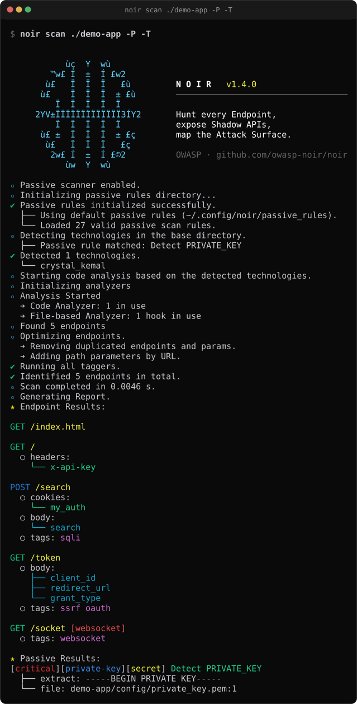

+++
title = "첫 번째 스캔"
description = "Noir로 첫 번째 스캔을 실행하고 결과를 살펴봅니다."
weight = 3
sort_by = "weight"
prev_page_path = "/get_started/installation/"
prev_page_label = "Noir 설치"

+++


Noir가 설치됐으니 바로 써보자! 프로젝트를 분석하고, 무엇을 찾았는지 확인하고, 출력을 다루는 방법을 배워보자.


여기서는 첫 스캔을 처음부터 끝까지 해 봅니다. 프로젝트를 지정하고, 결과를 읽고, 워크플로에 맞게 출력을 다듬습니다. 각 단계는 앞 단계에 이어지니 처음에는 순서대로 따라가세요.

## 스캔 실행

프로젝트 디렉터리를 골라 스캔합니다.

```bash
noir scan /path/to/your/app
```

이미 프로젝트 안에 있다면:

```bash
noir scan .
```



Noir는 소스 파일을 읽고 어떤 프레임워크를 쓰는지 탐지한 뒤, 찾은 엔드포인트를 메서드, 경로, 파라미터, 헤더, 쿠키와 함께 모두 출력합니다.

> **v0 호환:** `noir -b ./app` 같은 v0 형식도 고치지 않고 그대로
> 동작합니다. 플래그로 시작하는 호출은 라우터가 `scan`으로
> 보냅니다.

## 탐지된 기술 확인

Noir가 어떤 기술을 탐지했는지 궁금하면 `--include techs`를 붙여 결과와 함께 보세요.

```bash
noir scan . --include techs
```

Noir가 분석할 수 있는 모든 기술을 보려면:

```bash
noir list techs
```

목록에 없는 프레임워크라면 [AI 기반 분석](@/get_started/ai_power/index.ko.md)으로 엔드포인트를 탐지할 수 있습니다.

## 다른 출력 형식 써 보기

기본 출력은 터미널에서 읽기 위한 plain 텍스트입니다. 워크플로에 따라 다른 형식이 필요할 수 있습니다.

```bash
# 스크립트와 파이프라인에 적합한 JSON
noir scan . -f json

# 읽기 쉽고 설정 파일과 잘 맞는 YAML
noir scan . -f yaml

# API 문서 생성이나 도구 연동에 쓰는 OpenAPI 명세
noir scan . -f oas3

# 실제 대상에 바로 실행할 수 있는 cURL 명령
noir scan . -f curl -u https://your-target.com
```

지원하는 형식 전체는 `noir list formats`나 [출력 형식](@/usage/output_formats/_index.ko.md) 섹션에서 볼 수 있습니다.

## 결과를 파일로 저장

터미널에 출력하는 대신 `-o`로 파일에 씁니다.

```bash
noir scan . -f json -o results.json
```

스캔 결과를 서로 비교하거나, CI 파이프라인에 넘기거나, 팀과 공유할 때 쓸모 있습니다.

## 엔드포인트를 소스까지 추적

엔드포인트가 정확히 어디에 정의됐는지 알고 싶으면 `--include path`를 붙여 소스 파일 위치를 보세요.

```bash
noir scan . --include path
```

여러 항목을 한 플래그에 묶을 수 있습니다.

```bash
noir scan . --include path,techs
```

## 스캔 범위 좁히기

큰 모노레포에는 여러 프레임워크가 섞여 있을 수 있습니다. 필요한 부분만 스캔하세요.

```bash
# Rails와 Django 디텍터만 실행 (나머지는 건너뜀)
noir scan . --only-techs rails,django

# 자동 탐지 결과에 더해 Rails·Django 분석기도 함께 실행
noir scan . --techs rails,django

# Express만 빼고 전부 스캔
noir scan . --exclude-techs express

# 모노레포에서 glob 패턴으로 파일 제외 (쉼표로 구분)
noir scan . --exclude-path "*_test.go,vendor/*,**/node_modules/**"
```

`--only-techs`와 `--techs`는 비슷해 보이지만 하는 일이 다릅니다.
`--only-techs`는 실행할 디텍터를 제한합니다(지정한 디텍터만 돌아서 스캔이 빨라짐).
`--techs`는 자동 탐지 결과 *위에* 분석기 집합에 기술을 더합니다
(탐지가 놓쳐도 그 분석기는 실행됨).
"이 기술만, 탐지되지 않아도 실행"하고 싶다면 둘을 함께 쓰세요.

## 출력 보강하기

`--include`는 plain 출력에 엔드포인트별 정보를 더하고,
`--ai-context`는 AI 감사자를 위한 리뷰 컨텍스트를 붙입니다.

```bash
# 라우트 본문 안의 1-hop 핸들러 callee 첨부
noir scan . --include callee

# AI 리뷰용 컨텍스트 첨부 (guards, callees, sources, sinks, validators, signals)
noir scan . --ai-context

# AI 컨텍스트 범위 좁히기
noir scan . --ai-context guards,sinks
```

필터링해도 관련 근거는 함께 남습니다. `signals`를 고르면 각 시그널이
근거로 삼은 버킷도 함께 남습니다(예: `ssrf` 시그널은 `sinks`와 `sources`를
유지). 다른 버킷만 고르면 그 버킷에 기대는 시그널만 남습니다.
`priority_review` 요약은 `signals`를 골랐을 때만 나옵니다.

데이터 모양과 프레임워크별 지원은 [Callee 커버리지](@/usage/supported/callee_coverage/index.ko.md)와 [AI 컨텍스트](@/usage/supported/ai_context_coverage/index.ko.md)를 참고하세요.

## 주요 플래그 정리

| 플래그                | 역할 |
|----------------------|---|
| positional 경로       | 스캔할 디렉터리(하나 이상). 예: `noir scan ./api ./worker` |
| `-b <경로>`           | positional 경로와 같음, v0 호환 |
| `-f <형식>`           | 출력 형식 (json, yaml, oas3, curl 등) |
| `-o <파일>`           | 출력을 파일로 저장 |
| `-u <URL>`            | 경로 앞에 붙는 기본 URL. `--status-codes`, `--probe`, `--probe-via`에 필요 |
| `--include LIST`      | plain 출력에 `path`, `techs`, `callee` 추가 (쉼표 구분) |
| `--ai-context [LIST]` | AI 리뷰 컨텍스트 첨부 (`guards`, `callee`, `sources`, `sinks`, `validators`, `signals`, 또는 `all`) |
| `--pvalue TYPE=VAL`   | 출력에 파라미터 값 채우기 (TYPE: any / header / cookie / query / form / json / path) |
| `--only-techs`        | 이 디텍터만 실행 (나머지 건너뜀) |
| `--techs`             | 자동 탐지 결과에 더해 이 기술을 분석기 집합에 추가 |
| `--exclude-techs`     | 탐지 후 결과에서 이 기술 제외 |
| `--exclude-path`      | 쉼표 구분 glob 패턴에 매치되는 파일 제외. `/`가 있는 패턴은 스캔 기준 경로, 없는 패턴은 파일·디렉터리 이름과 비교하며, 디렉터리가 매치되면 그 아래 전체를 제외 |
| `--status-codes`      | 각 엔드포인트를 호출해 응답 HTTP 상태 코드를 첨부 |
| `--exclude-codes`     | 응답 상태가 매치되는 엔드포인트 제외 (쉼표 구분, `--status-codes`와 함께) |
| `-P, --passive-scan`  | 패시브 보안 스캔 활성화 |
| `-T, --use-all-taggers` | 모든 태거 활성화 |
| `--probe`             | 발견된 엔드포인트에 HTTP 요청 실행 (`-u` 필요) |
| `--probe-via <url>`   | 프로브를 이 프록시 URL로 라우팅 |
| `--probe-header VAL`  | 각 프로브에 헤더 추가 (반복 가능) |
| `--tls-skip-verify`   | 프로브/내보내기/웹훅의 TLS 인증서 검증 건너뛰기 (비보안) |
| `--use-taggers LIST`  | 특정 태거만 활성화 (쉼표 구분; `noir list taggers` 참고) |
| `--export-es <url>`   | 엔드포인트를 Elasticsearch에 인덱싱 |
| `--export-opensearch <url>` | 엔드포인트를 OpenSearch에 인덱싱 (`--export-es`와 같은 전송 형태) |
| `--export-webhook <url>` | 엔드포인트 카탈로그를 JSON으로 웹훅에 POST |
| `--ai-provider`        | AI 제공업체 접두사 또는 전체 URL ([AI 기반 분석](@/get_started/ai_power/index.ko.md) 참고) |
| `--ai-model NAME`     | AI 모델 이름 |
| `--ai-key KEY`        | AI API 키 (프로세스 목록에 노출되므로 `NOIR_AI_KEY` 또는 `--ai-key-file PATH` 권장) |
| `--diff-path <path>`  | [Diff 모드](@/usage/more_features/diff/index.ko.md)용 이전 코드 경로 |
| `--diff-ref <ref>`    | 비교할 git 리비전 (예: `main`, `HEAD~1`; [Diff 모드](@/usage/more_features/diff/index.ko.md) 참고) |
| `--fail-on <list>`    | diff에 `added`, `removed`, `changed`, `auth-removed` 중 하나라도 있으면 종료 코드 `3` |
| `--passive-scan-severity LVL` | 패시브 스캔 최소 심각도 (`critical`, `high`, `medium`, `low` 중 하나; 기본 `high`) |
| `-d, --debug`         | 디버그 메시지 활성화 |
| `--config-file <경로>`| YAML 설정 파일에서 기본 옵션 로드 |
| `--concurrency <N>`   | 워커 수 (기본값: CPU 수, 4–32로 clamp; 또는 `NOIR_CONCURRENCY`) |
| `--cache-disable`     | 이번 실행에 한해 LLM 응답 캐시 비활성화 |
| `--cache-clear`       | 실행 전에 LLM 응답 캐시 초기화 |
| `--strict`            | 분석기가 실패했거나 건너뛴 파일이 있으면 종료 코드 2 반환 (결과 출력은 그대로) |
| `--verbose`           | 자세한 로그. `--include path`와 `--use-all-taggers`도 함께 켬 |
| `--no-log`            | 로그를 숨기고 결과만 표시 |
| `--no-color`          | plain 출력의 ANSI 색상 비활성화 |
| `--no-spinner`        | 로딩 스피너 애니메이션 비활성화 |

빌드 정보(Crystal / LLVM / 타깃)는 `noir version --verbose`로 확인합니다. `noir help` 는 최상위 개요를, `noir help <command>` 는 해당 명령어의 전체 플래그 목록을 보여줍니다.

---

시작하기 가이드를 마쳤습니다! 다음으로 볼 만한 내용:

- **[CLI 명령어](@/usage/cli_commands/_index.ko.md)**: v1 서브커맨드(scan, list, cache, config, rules 등) 전체 레퍼런스
- **[설정](@/usage/configurations/configuration_file/index.ko.md)**: 매번 플래그를 반복하지 않도록 기본 옵션 설정
- **[출력 형식](@/usage/output_formats/_index.ko.md)**: 모든 출력 형식 자세히 보기
- **[Diff 모드](@/usage/more_features/diff/index.ko.md)**: 경로나 git 리비전과 공격 표면을 비교하고 `--fail-on`으로 CI를 게이트
- **[패시브 스캔](@/usage/passive_scan/_index.ko.md)**: 하드코딩된 비밀키, 잘못된 설정 등 보안 이슈 스캔
- **[AI 기반 분석](@/get_started/ai_power/index.ko.md)**: AI로 지원하지 않는 프레임워크의 엔드포인트 탐지
