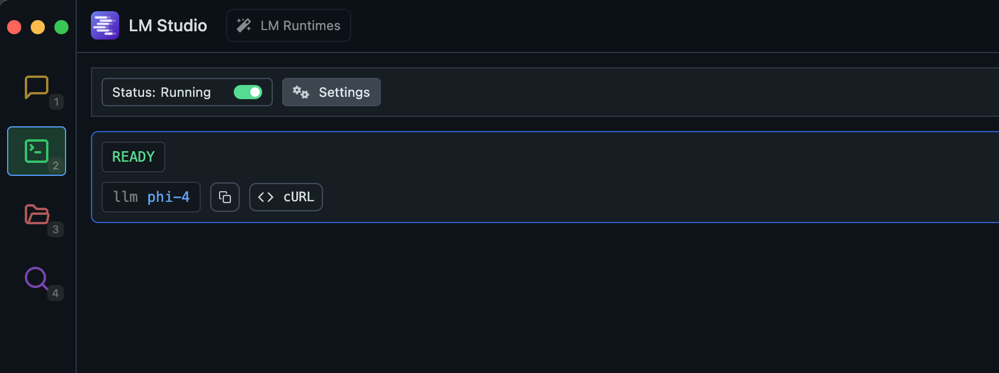

+++
title = "LM Studio와 함께 Noir 사용하기"
description = "LM Studio를 Noir에 연결해 코드를 로컬에서 비공개로 분석하는 방법입니다."
weight = 3
sort_by = "weight"

+++

[LM Studio](https://lmstudio.ai)로 언어 모델을 로컬에서 실행하면 코드를 외부로 보내지 않고 분석할 수 있습니다.

## 설정

1.  **LM Studio 설치**: [공식 웹사이트](https://lmstudio.ai)에서 다운로드하세요.
2.  **로컬 서버 시작**: LM Studio를 열고 Developer 탭에서 모델을 로드한 뒤 서버 상태를 Running으로 켜세요.

    

## 사용 방법

```bash
noir scan ./spec/functional_test/fixtures/hahwul \
     --ai-provider=lmstudio \
     --ai-model <MODEL_NAME>
```

`<MODEL_NAME>`을 LM Studio에서 서빙 중인 모델 이름으로 바꾸세요. `lmstudio` 프리셋은 `http://localhost:1234/v1`을 가리킵니다. 포트를 바꿨다면 URL을 직접 넘기세요.
