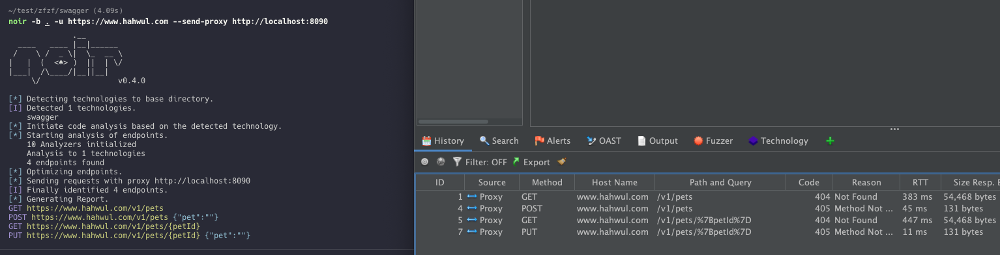
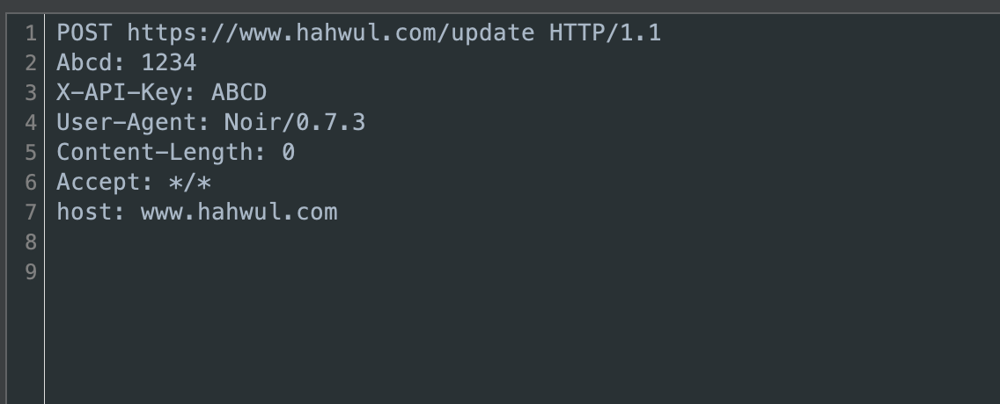
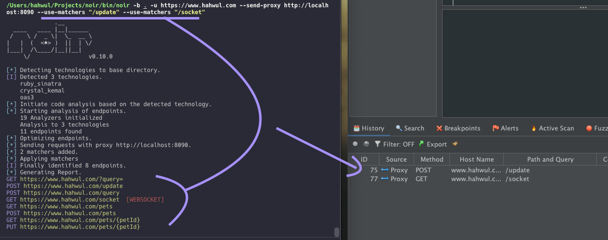

+++
title = "다른 도구로 결과 전송하기"
description = "Burp/ZAP을 거쳐 엔드포인트에 요청을 보내거나(probe), Elasticsearch나 웹훅으로 내보냅니다(export)."
weight = 1
sort_by = "weight"

+++

Noir의 결과 전송은 성격이 다른 두 갈래로 나뉩니다.

- **PROBE**: 방금 찾은 엔드포인트에 실제 HTTP 요청을 보냅니다(능동 재전송). 필요하면 Burp Suite나 ZAP 같은 프록시를 거칩니다.
- **EXPORT**: 엔드포인트 목록을 외부 저장소(Elasticsearch, OpenSearch, 임의의 웹훅 수신기)에 데이터로 보냅니다. 엔드포인트 자체에는 HTTP 트래픽이 가지 않습니다.


Probe는 재전송, Export는 적재. 결과가 어디로 가야 하는지에 맞춰 고르면 돼.


## Probe

관련 플래그:

| 플래그 | 용도 |
| --- | --- |
| `--probe` | 찾은 엔드포인트마다 HTTP 요청 전송 (`-u` 필요) |
| `--probe-via URL` | 이 프록시 URL을 거쳐 요청 전송 |
| `--probe-header VAL` | 모든 요청에 헤더 추가 (반복 가능) |
| `--probe-match VAL` | 패턴에 맞는 엔드포인트에만 요청 (URL, 메서드, `method:URL`) |
| `--probe-skip VAL` | 패턴에 맞는 엔드포인트는 건너뜀 |

`--probe`와 `--probe-via`는 서로 독립적입니다. 둘을 함께 주면 모든 엔드포인트에 요청이 두 번 나갑니다(프록시 경유 1회, 직접 1회). 타깃 부하가 두 배가 되므로, 프록시에 트래픽만 쌓고 싶다면 `--probe-via`만 주세요.

### 경로 템플릿

`/users/{id}` 같은 라우트는 그대로 요청할 수 없으므로, noir가 요청 전에 플레이스홀더를 채웁니다. 단 **읽기 전용 메서드에만** 적용합니다(GET, HEAD, OPTIONS, QUERY). 숫자로 보이는 이름(`id`, `page`, `*_id` 등)에는 `1`, 나머지에는 `noir`가 들어갑니다.

POST, PUT, PATCH, DELETE는 템플릿을 그대로 둡니다. 여기서 값을 채우면 무해한 404가 실제 쓰기 요청으로 바뀝니다(실제 레코드에 `DELETE /users/1`이 나감). 그래서 noir가 대신 채우지 않습니다. 프록시를 거치면 템플릿 그대로 도착하니, 필요하면 직접 고쳐서 다시 보내세요.

값을 직접 지정하려면 `--pvalue path=...`를 쓰세요. 이 값은 모든 메서드에 적용됩니다.

```bash
noir scan ./source -u http://localhost:3000 --probe --pvalue path=id=42
```

자동 채우기는 나가는 요청에만 적용되고, 리포트에는 원래 템플릿이 남습니다. `--pvalue path=...` 값은 다릅니다. 리포트의 URL에도 들어갑니다(`/users/:id`가 `/users/42`로 표시됨).

### 프록시로 재전송

모든 엔드포인트를 로컬 Burp/ZAP 프록시로 보내 스캐너가 가져가게 합니다.

```bash
noir scan ./source -u http://localhost:3000 --probe-via http://localhost:8080
```

프록시 포트는 꼭 적어야 합니다. `--probe-via http://localhost`는 포트를 추측하지 않고 거부합니다. 포트 없는 프록시 URL로는 라우팅할 수 없고, 그대로 두면 요청이 프록시를 건너뛰고 타깃으로 바로 나가기 때문입니다. `curl -x`가 받는 `host:port` 형태는 받아들이며 `http://host:port`로 읽습니다.



### 사용자 지정 헤더

인증 토큰 같은 헤더를 모든 요청에 붙입니다.

```bash
noir scan ./source -u http://localhost:3000 \
  --probe-via http://localhost:8080 \
  --probe-header "Authorization: Bearer your-token"
```



이 헤더는 `-u` 타깃에만 붙습니다. 엔드포인트는 대부분 noir가 `-u` 뒤에 붙인 경로입니다. 하지만 소스에 scheme과 호스트가 이미 적혀 있던 엔드포인트(OAS `servers:` 항목, HAR 캡처, 호스팅 백엔드 URL)는 그 호스트를 그대로 쓰고, 그 호스트는 지금 스캔하는 코드에서 온 값입니다. 이런 엔드포인트에도 요청은 나가지만 헤더는 붙지 않습니다. noir는 헤더를 뺀 호스트를 한 번 알려줍니다.

```
▲ Probe: --probe-header values withheld from https://collector.example.com — it is not the --url target. Endpoints on that host are still probed, without your headers.
```

내보내기 대상(`--export-es`, `--export-webhook`)은 영향을 받지 않습니다. 그 호스트는 직접 지정한 것이므로 `--probe-header`가 그대로 인증에 쓰입니다.

### Match / skip

프록시로 보낼 엔드포인트를 좁힐 수 있습니다. 패턴에는 URL 부분 문자열, HTTP 메서드(대소문자 무시), `method:URL` 조합을 쓸 수 있습니다.

```bash
# API 엔드포인트만
noir scan ./source -u http://localhost:3000 --probe-via http://localhost:8080 --probe-match "api"

# GET 요청만
noir scan ./source -u http://localhost:3000 --probe-via http://localhost:8080 --probe-match "GET"

# POST 요청 제외
noir scan ./source -u http://localhost:3000 --probe-via http://localhost:8080 --probe-skip "POST"

# /api 경로의 POST만
noir scan ./source -u http://localhost:3000 --probe-via http://localhost:8080 --probe-match "POST:/api"

# /admin 경로의 GET 제외
noir scan ./source -u http://localhost:3000 --probe-via http://localhost:8080 --probe-skip "GET:/admin"
```

지원 메서드: GET, POST, PUT, DELETE, PATCH, HEAD, OPTIONS, TRACE, CONNECT, QUERY.

`--probe-match`와 `--probe-skip`은 여러 번 쓸 수 있고, 함께 적용됩니다.

```bash
noir scan ./source -u http://localhost:3000 \
  --probe-via http://localhost:8080 \
  --probe-match "GET" --probe-match "POST:/api"
```



## Export

엔드포인트 목록을 외부 저장소로 보냅니다. probe와 달리 엔드포인트 자체에는 트래픽이 가지 않습니다.

| 플래그 | 용도 |
| --- | --- |
| `--export-es URL` | 목록을 Elasticsearch에 색인 |
| `--export-opensearch URL` | 위와 같고 OpenSearch용 (이 요청 형태에서는 프로토콜이 같음) |
| `--export-webhook URL` | 목록을 JSON 문서 하나로 HTTP 수신기에 POST |

### Elasticsearch / OpenSearch

문서 엔드포인트의 전체 URL을 넘기세요. Noir는 받은 URL 그대로 POST하며, 인덱스나 `_doc` 경로를 따로 붙이지 않습니다.

```bash
noir scan ./source --export-es http://localhost:9200/noir/_doc
```

포트가 없는 `http://` URL은 9200 포트를 씁니다. 포트가 없는 `https://` URL은 scheme 기본값(443)을 그대로 씁니다. 관리형 클러스터(AWS OpenSearch Service, Elastic Cloud)와 TLS 리버스 프록시가 443에서 받기 때문입니다.

인증은 `--probe-header`를 재사용합니다. 이름과 달리 이 헤더는 export 요청에도 붙습니다.

```bash
noir scan ./source --export-es https://my.cloud.es.io/noir/_doc \
  --probe-header "Authorization: ApiKey <base64-key>"
```

### Webhook

목록 전체를 JSON 문서 하나로 POST합니다.

```bash
noir scan ./source --export-webhook https://hooks.example.com/noir
```

본문에는 필드 세 개가 들어갑니다.

| 필드 | 내용 |
| --- | --- |
| `endpoints` | `-f json`이 출력하는 것과 동일한 배열 |
| `endpoint_count` | `endpoints`의 항목 수 |
| `noir_version` | 이 문서를 만든 noir 버전 |

Slack incoming webhook, Discord 웹훅, Zapier/n8n 트리거, 사내 수신기는 모두 임의의 JSON 본문을 받으므로, 형식 하나로 흔한 목적지를 다 쓸 수 있습니다. 특정 플랫폼 형식(예: Slack의 `{"text": ...}` 블록)이 필요하면 noir에 플랫폼별 포매터를 기대하지 말고 변환기를 중간에 두세요.

### TLS

probe와 export 모두 TLS 인증서를 검증합니다. 자체 서명 인증서를 쓰는 사내 호스트라면 `--tls-skip-verify`로 검증을 끌 수 있습니다.

프록시 전송은 예외입니다. `--probe-via`는 항상 검증을 건너뜁니다. 인터셉트 프록시는 자체 인증서를 내밀기 때문에, 검증하면 재전송하는 모든 요청이 핸드셰이크에서 실패합니다.

## v0 별칭

v0.x 플래그 이름도 그대로 동작합니다. Noir가 내부에서 조용히 바꿔 줍니다.

| v0 플래그 | v1 플래그 |
| --- | --- |
| `--send-req` | `--probe` |
| `--send-proxy URL` | `--probe-via URL` |
| `--send-es URL` | `--export-es URL` |
| `--with-headers VAL` | `--probe-header VAL` |
| `--use-matchers VAL` | `--probe-match VAL` |
| `--use-filters VAL` | `--probe-skip VAL` |

v0 이름을 쓰는 기존 CI 스크립트와 Dockerfile은 고치지 않아도 됩니다. 새 문서, 예제, 셸 자동 완성에는 v1 이름이 나옵니다.
