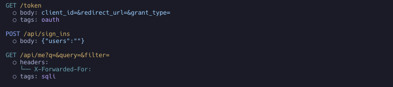

+++
title = "태거로 컨텍스트 분석하기"
description = "엔드포인트와 파라미터에 태그를 붙여 기능과 보안 위험 지점을 표시합니다."
weight = 3
sort_by = "weight"

+++

태거는 엔드포인트와 파라미터에 태그를 붙입니다. 태그는 엔드포인트가 무슨 일을 하는지, 어디가 위험할 수 있는지를 알려 줍니다. 예를 들어 SQL 인젝션에 열려 있을 수 있는 파라미터나 로그인 엔드포인트가 그렇습니다.


태그는 내 돋보기야. redirect_url 같은 파라미터는 핸들러를 읽기도 전에 ssrf로 표시돼.




## 사용법

태거는 기본으로 꺼져 있습니다. `--verbose`, `--ai-context`, `-f only-tag`를 주면 모두 켜집니다. 직접 고르려면 다음 플래그를 쓰세요.

**모든 태거 활성화** (`-T` / `--use-all-taggers`)

```bash
noir scan <BASE_PATH> -T
# 같은 명령: noir scan <BASE_PATH> --use-all-taggers
```

**특정 태거만 활성화** (`noir list taggers`로 목록 확인)

```bash
noir scan <BASE_PATH> --use-taggers hunt,oauth
```

## 출력

태그는 엔드포인트와 각 파라미터의 `tags` 배열에 들어갑니다. 태그마다 필드가 세 개 있습니다:

| 필드 | 의미 |
|---|---|
| `name` | 짧은 식별자. 예: `sqli`, `oauth` |
| `description` | 사람이 읽는 설명 |
| `tagger` | 태그를 붙인 태거. 예: 취약점 패턴은 `Hunt`, 인증 흐름은 `Oauth` |

```json
{
  "url": "/token",
  "method": "GET",
  "params": [
    {
      "name": "redirect_url",
      "value": "",
      "param_type": "form",
      "tags": [
        {
          "name": "ssrf",
          "description": "This parameter may be vulnerable to Server Side Request Forgery (SSRF) attacks.",
          "tagger": "Hunt"
        }
      ]
    }
  ],
  "protocol": "http",
  "tags": [
    {
      "name": "oauth",
      "description": "Suspected OAuth endpoint for granting 3rd party access.",
      "tagger": "Oauth"
    }
  ]
}
```

엔드포인트 태그는 AI 컨텍스트에도 신호로 들어가, AI 리뷰어가 읽는 엔드포인트별 요약에 함께 나옵니다.

## 태그 분류

현재 목록은 `noir list taggers`로 확인하세요.

| 분류 | 태거 | 태그를 붙이는 대상 |
|---|---|---|
| 파라미터 취약점 클래스 | `hunt` | 이름이 알려진 위험 패턴과 맞는 파라미터(`sqli`, `ssrf`, `idor`, `file-inclusion`, `command-injection` 등) |
| 프로토콜 / 인터페이스 | `graphql`, `soap`, `websocket`, `mcp`, `cors` | 해당 프로토콜이나 인터페이스를 쓰는 엔드포인트 |
| 인증 & 토큰 | `oauth`, `jwt` | OAuth와 JWT 인증 엔드포인트 |
| 프레임워크별 인증 | `django_auth`, `flask_auth`, `fastapi_auth`, `python_misc_auth`, `spring_auth`, `java_misc_auth`, `ktor_auth`, `scala_auth`, `express_auth`, `nestjs_auth`, `hono_auth`, `js_misc_auth`, `go_auth`, `rust_auth`, `ruby_auth`, `php_auth`, `aspnet_auth`, `fastendpoints_auth`, `elixir_auth`, `swift_auth`, `crystal_auth`, `perl_auth` | 로그인이 필요한 엔드포인트에 `auth` 태그. `nestjs_auth`와 `ruby_auth`는 역할이나 정책 검사가 걸린 라우트에 `authz`도 붙입니다 |
| 엔드포인트 용도 | `pii`, `admin`, `payment`, `webhook`, `crypto`, `debug`, `api_docs`, `account_recovery`, `file_upload` | 엔드포인트가 무엇을 위한 것인지(아래 참고) |
| 프레임워크 보호 장치와 위험 | `rails_security`, `spring_security`, `rust_security`, `go_security` | 보안 설정과, 꺼진 안전한 기본값(아래 참고) |

### 엔드포인트 용도

이 태그들은 엔드포인트가 무엇을 위한 것인지 알려 주므로, 리뷰어가 중요한 것부터 볼 수 있습니다. 태그 이름은 태거 이름과 같습니다.

| 태그 | 표시하는 대상 | 확인할 점 |
|---|---|---|
| `pii` | 개인정보(주민번호, 카드 정보, 연락처)를 다루는 엔드포인트 | 데이터 노출과 과도한 수집 |
| `admin` | 관리자·특권 라우트(`/admin`, 권한을 바꾸는 파라미터) | 접근 제어 우회와 권한 상승 |
| `payment` | 결제·금융 거래 엔드포인트 | 금액·가격 조작, 통화 혼동, 금융 레코드 IDOR |
| `webhook` | 들어오는 웹훅·콜백 엔드포인트 | 서명 검증, 재전송 방어, 바깥으로 나가는 호출의 SSRF |
| `crypto` | 암복호화, 서명, 해시, 키 관리를 하는 엔드포인트 | 약한 알고리즘, 패딩/서명 오라클, IV·salt 재사용, 키 노출 |
| `debug` | 디버그·진단·내부 전용 엔드포인트(디버그 콘솔/토글, 프로파일러, actuator/management, pprof, heap/thread dump, `/internal` API) | 외부에 열려 있으면 안 됩니다. 정보 노출과 위험한 진단 동작을 확인하세요 |
| `api_docs` | API 문서/스키마 엔드포인트(Swagger, OpenAPI, GraphiQL, ReDoc, WSDL) | API 전체를 보여 주고, 인증 없이 열려 있는 경우가 많습니다 |
| `account_recovery` | 비밀번호 재설정/변경, 이메일 변경, MFA/OTP, 본인 확인 엔드포인트. 계정 탈취가 주로 일어나는 곳입니다 | 리셋 토큰 유출, 재설정 링크의 host-header 인젝션, 계정 열거, 레이트 리밋 부재 |
| `file_upload` | 파일 업로드 엔드포인트 | 무제한 업로드, 경로 탐색, 악성 파일 처리 |

### 프레임워크 보호 장치와 위험

이 태거들은 해당 엔드포인트에 두 가지를 표시합니다. 프레임워크의 보안 설정, 그리고 코드가 프레임워크의 안전한 기본값을 끈 지점입니다.

**Rails** (`rails_security`)

| 태그 | 표시하는 대상 |
|---|---|
| `csrf-protection` | CSRF 검증이 비활성화(`skip_before_action :verify_authenticity_token`, `skip_forgery_protection`)되었거나 약화(`protect_from_forgery with: :null_session`)된 경우. Rails는 상태를 바꾸는 요청을 기본으로 보호하므로, 일부러 끈 곳은 모두 확인하세요 |
| `mass-assignment` | Strong Parameters가 우회된 경우(`params.permit!`, `params.to_unsafe_h`, 또는 `Model.new(params[:user])`처럼 가공되지 않은 `params[:x]` 해시를 모델 라이터에 전달). 권한 플래그나 소유자 컬럼 같은 필드를 공격자가 쓸 수 있는지 확인하세요 |
| `rate-limit` | Rails 8 기본 `rate_limit` 매크로로 요청 수를 제한하는 액션. 로그인·복구 라우트에 이것이 없으면 그 자체가 발견 사항입니다 |

**Spring** (`spring_security`). 인증 태거 `spring_auth`를 보완합니다.

| 태그 | 표시하는 대상 |
|---|---|
| `csrf-protection` | `SecurityFilterChain`에서 CSRF를 끈 경우. 전체를 끄든(`csrf().disable()`, `csrf(AbstractHttpConfigurer::disable)`, Kotlin `csrf { disable() }`) 특정 경로만 빼든(`csrf(c -> c.ignoringRequestMatchers("/api/**"))`) 영향받는 POST/PUT/PATCH/DELETE 엔드포인트에 표시하며, 체인에 `securityMatcher`가 있으면 그 범위로 한정합니다. 토큰 API에서는 흔하지만 그래도 확인하세요 |
| `cors` | 핸들러/컨트롤러의 `@CrossOrigin` 애너테이션이나 전역 `WebMvcConfigurer` 매핑(`addMapping(...).allowedOrigins("*")`). 둘 다 엔드포인트의 브라우저 동일 출처 제한을 풉니다. 와일드카드 출처(`*`), 특히 자격 증명과 함께 쓰면 허용 범위가 넓은(permissive) 설정으로 표시합니다 |
| `security-headers` | Spring 기본 응답 헤더 보호를 약하게 만든 경우: 클릭재킹 보호 해제(`frameOptions().disable()`) 또는 헤더 라이터 전체 비활성화(`headers().disable()` / `headers(HeadersConfigurer::disable)`) |
| `input-validation` | `@Valid` / `@Validated`로 요청 본문에 Bean Validation을 적용한 경우. `@RequestBody`를 받으면서 이 태그가 없는 핸들러가 눈에 띕니다 |

**Rust** (`rust_security`, Actix-Web·Axum/tower-http·Rocket·Loco·Warp 등). Rust 프레임워크는 기본으로 켜 주는 보호 장치가 없습니다. 태거는 실제로 연결된 것(`.wrap(..)`/`.layer(..)` 미들웨어나 Loco의 `config/*.yaml`)을 기록하고 위험한 설정을 표시합니다.

| 태그 | 표시하는 대상 |
|---|---|
| `cors` | CORS 미들웨어. 허용 범위가 넓은 설정(`Cors::permissive()`, `CorsLayer::very_permissive()`, `allow_any_origin`, `allow_origins: ["*"]`)은 위험으로 표시하고, 제한된 허용 목록은 참고 정보로 기록합니다 |
| `rate-limit` | 요청 수 제한(`actix-governor`, `tower_governor`, `actix-limitation`, tower limit 레이어). 감싸는 스코프에 매핑되므로 제한이 없는 라우트를 알 수 있습니다 |
| `security-headers` | 라우트에 설정된 강화 응답 헤더(HSTS, CSP, `X-Frame-Options`, `X-Content-Type-Options` 등) |
| `body-limit` | 요청 본문 크기 제한(DoS 완화). 제한을 끄면(`DefaultBodyLimit::disable()`) 위험으로 표시합니다 |

**Go** (`go_security`). Go는 이런 미들웨어를 기본으로 켜지 않으므로, 있는지(또는 상태를 바꾸는 라우트에 없는지)가 신호입니다. 태거는 보호 미들웨어를 각 엔드포인트에 매핑합니다. Echo, Gin, Fiber, Chi 등에서 그룹 단위 `.Use(...)`, 전역 래퍼, 라우트별 미들웨어를 읽습니다.

| 태그 | 표시하는 대상 |
|---|---|
| `csrf-protection` | 라우트의 CSRF 미들웨어(Echo `middleware.CSRF`, Fiber `csrf.New`, gorilla/csrf `csrf.Protect`, gin-csrf, `nosurf`). 쿠키 인증을 쓰는 상태 변경 라우트에 없다면 확인하세요 |
| `security-headers` | 응답 강화 미들웨어(Echo `middleware.Secure`, Fiber `helmet`, unrolled/gin-contrib `secure`). HSTS / `X-Frame-Options` / nosniff / XSS 보호 헤더를 설정합니다 |
| `rate-limit` | 요청 수 제한 미들웨어(Echo `RateLimiter`, chi `Throttle`, Fiber/ulule `limiter`, go-chi/httprate, tollbooth). 무차별 대입이나 남용에 열린 라우트를 보여 줍니다 |
| `body-limit` | 요청 본문 크기 제한(Echo `BodyLimit`, gin-contrib/size). DoS 방어용입니다 |
| `timeout` | 요청 타임아웃 미들웨어(Echo/chi `middleware.Timeout`, Fiber `timeout`). 느린 요청 방어용입니다 |
| `cors` | CORS 미들웨어(Echo `middleware.CORS`, Fiber/gin-contrib/go-chi/rs `cors`, gorilla `handlers.CORS`). 허용 범위가 넓다고 알려진 생성자(`cors.Default()`, `cors.AllowAll()`)는 모든 origin 허용으로 표시합니다. 헤더 파라미터를 보는 `cors` 태거에 더해지는 태그입니다 |
| `secure-cookies` | 쿠키 기밀성/무결성 미들웨어(Fiber `encryptcookie`) |
