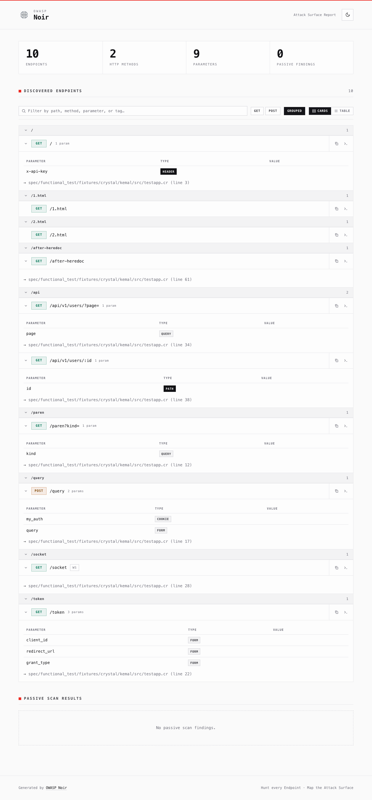
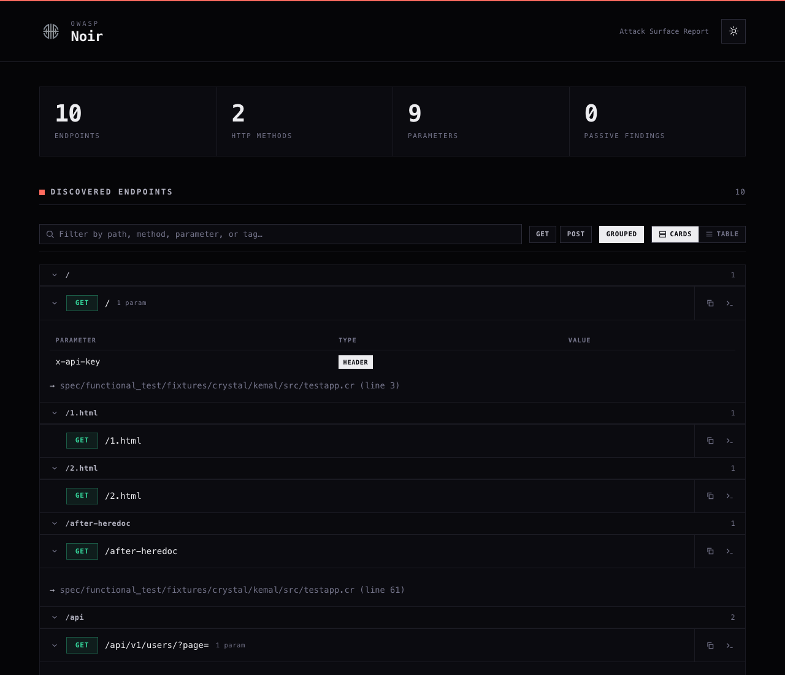
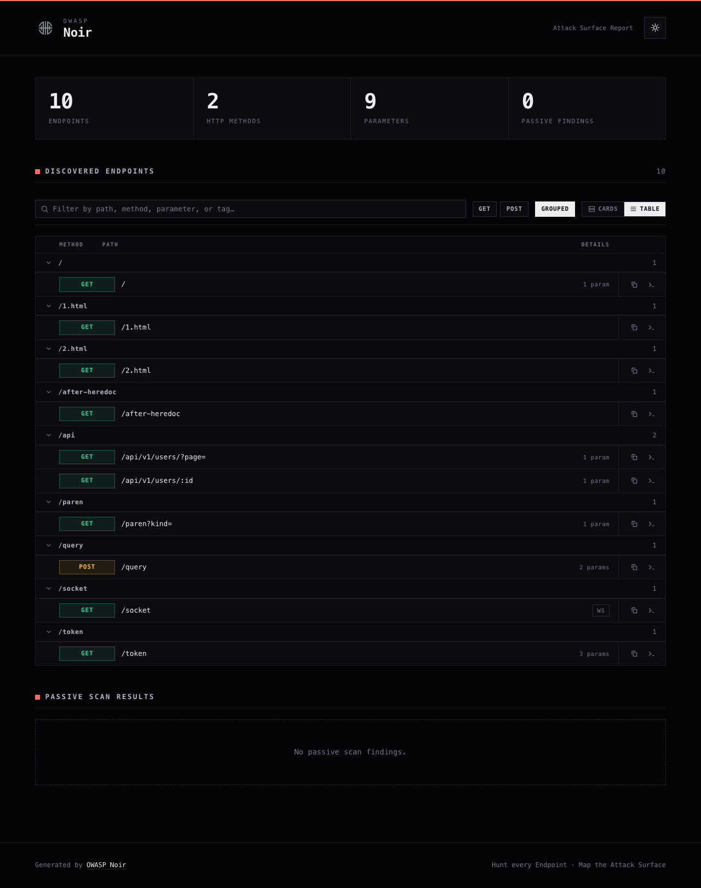

+++
title = "HTML 리포트"
description = "공격 표면 스캔 결과를 담은 단일 파일 인터랙티브 HTML 리포트를 생성합니다."
weight = 3
sort_by = "weight"

+++

스캔 결과를 인터랙티브 HTML 파일 하나로 만듭니다. 외부 의존성이 없어서 오프라인에서도 열리고 공유하기 쉽습니다. 색은 의미가 있는 곳에만 씁니다. HTTP 메서드와 발견 항목의 심각도마다 색이 따로 있습니다.

## 기본 사용법

```bash
noir scan . -f html -o report.html
```

## 미리보기

아래 스크린샷은 Noir의 Kemal 테스트 픽스처로 만든 실제 리포트입니다. 저장소를 받아 그대로 재현할 수 있습니다.

```bash
noir scan -b spec/functional_test/fixtures/crystal/kemal -f html -o report.html
```



다크 테마도 있습니다. 우측 상단 컨트롤로 바꿀 수 있고, 선택은 `localStorage`에 저장됩니다. 처음 열 때는 운영체제의 `prefers-color-scheme` 설정을 따릅니다.



스캔 결과가 많으면 Cards / Table 컨트롤로 테이블 뷰로 바꾸세요. 같은 엔드포인트가 촘촘한 행으로 표시되어 경로가 수백 개여도 빨리 훑어볼 수 있습니다.



### 리포트 구성

- 요약: 엔드포인트, HTTP 메서드, 파라미터, 패시브 스캔 결과 개수
- 엔드포인트: 엔드포인트마다 접을 수 있는 카드 하나. 메서드 색 배지(GET 에메랄드, POST 앰버, PUT 블루, PATCH 바이올렛, DELETE 레드)와, WebSocket 같은 비-HTTP 엔드포인트에는 프로토콜 배지가 붙음
- 경로 그룹: 첫 번째 경로 세그먼트(절대 URL은 호스트)로 엔드포인트를 묶고, 접을 수 있는 그룹 헤더와 그룹별 개수를 표시
- 파라미터: 엔드포인트마다 각 파라미터의 이름, 타입(query, form, json, header, cookie, path, file, xml 등), 값을 담은 테이블
- 패시브 스캔 결과: `-P`를 쓰면 설명, 심각도 색 배지, 매칭된 코드 스니펫과 함께 표시
- 소스 위치: 각 엔드포인트가 정의된 파일 경로와 줄 번호

### 인터랙티브 기능

아래 기능은 서버나 네트워크 없이 HTML 파일 하나로 동작합니다.

- 라이트 / 다크 테마 토글. 선택은 다음에 열 때도 유지
- 카드 / 테이블 뷰 토글. 이 선택도 유지
- 경로 그룹: 검토를 마친 그룹은 접어 두고, Grouped 토글로 목록을 펼칠 수 있음. 필터를 바꾸면 그룹별 개수도 바로 갱신
- 검색: 경로, 메서드, 파라미터, 태그로 엔드포인트를 거르고 "표시 / 전체" 개수를 보여줌
- 엔드포인트와 패시브 결과 목록을 좁히는 메서드·심각도 필터 칩
- 엔드포인트마다 복사 버튼: URL, 또는 메서드·파라미터·헤더·쿠키로 만든 curl 명령을 복사
- 인쇄할 때는 모든 카드와 그룹을 펼치고 컨트롤을 숨김. `prefers-reduced-motion` 설정도 따름

## 템플릿 커스터마이징

회사 브랜딩을 넣는 등 직접 만든 템플릿을 쓸 수 있습니다.

### 템플릿 위치

Noir는 아래 경로에서 `report-template.html` 파일을 찾습니다.

- Linux/macOS: `~/.config/noir/report-template.html`
- Windows: `%APPDATA%\noir\report-template.html`
- `NOIR_HOME`이 설정된 경우: `$NOIR_HOME/report-template.html`

파일이 있으면 내장 템플릿 대신 이 파일을 씁니다.

### 플레이스홀더

템플릿에 아래 플레이스홀더를 넣으면 Noir가 생성한 내용으로 바꿉니다.

| 플레이스홀더 | 설명 |
| :--- | :--- |
| `<%= noir_head %>` | 기본 CSS, 메타데이터, 페인트 전 테마 초기화 스크립트를 포함한 `<head>` 태그 내용 |
| `<%= noir_header %>` | 제목, 브랜드 마크, 테마 토글이 포함된 헤더 섹션 |
| `<%= noir_summary %>` | 요약 대시보드 (카운트 카드) |
| `<%= noir_endpoints %>` | 검색창, 필터 칩, 뷰 토글, 경로 그룹을 포함한, 발견된 엔드포인트 목록 섹션 |
| `<%= noir_passive_scans %>` | 패시브 스캔 결과 섹션 |
| `<%= noir_footer %>` | 푸터 섹션 |
| `<%= noir_scripts %>` | 인터랙티브 스크립트 (테마 토글, 접이식 카드·그룹, 검색, 필터, 뷰 전환, 복사 버튼) |


noir_scripts 플레이스홀더를 잊지 마세요. 템플릿의 닫는 body 태그 바로 앞에 추가하면 됩니다. 없어도 리포트는 렌더링되지만 테마 토글, 접이식 카드, 검색, 필터, 뷰 전환, 복사 버튼이 동작하지 않습니다.


### 예제 템플릿

회사 헤더를 추가하고, Noir의 스타일과 섹션, 스크립트는 플레이스홀더로 재사용하는 간단한 템플릿입니다.

```html
<!DOCTYPE html>
<html lang="en">
<head>
    <!-- 기본 스타일 및 페인트 전 테마 초기화 스크립트 포함 -->
    <%= noir_head %>
    <style>
        /* 사용자 정의 스타일 추가 */
        body { background-color: #f0f2f5; }
        .company-header { padding: 20px; text-align: center; background: #333; color: #fff; }
    </style>
</head>
<body>
    <div class="company-header">
        <h1>My Company Security Report</h1>
    </div>

    <!-- 원래 헤더 -->
    <%= noir_header %>

    <main class="container">
        <!-- 요약 섹션 -->
        <%= noir_summary %>

        <h2>Detailed Findings</h2>

        <!-- 엔드포인트 목록 -->
        <%= noir_endpoints %>

        <!-- 패시브 스캔 결과 -->
        <%= noir_passive_scans %>
    </main>

    <%= noir_footer %>

    <!-- 인터랙티브 기능: 테마 토글, 접이식 카드, 검색, 필터 -->
    <%= noir_scripts %>
</body>
</html>
```

`~/.config/noir/report-template.html`로 저장하면 이후 `-f html` 실행에 모두 적용됩니다.
